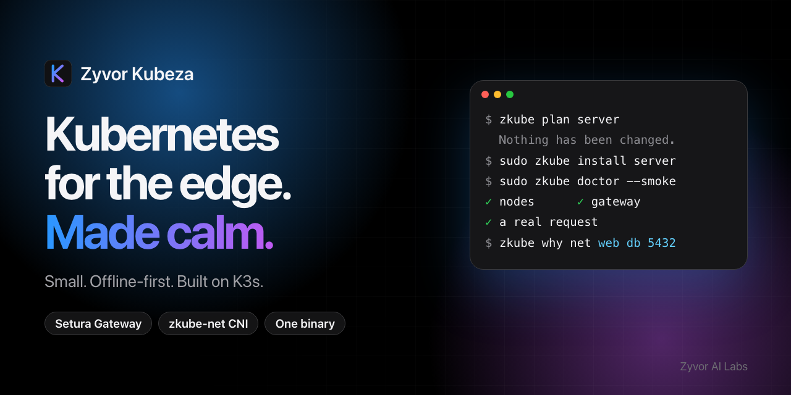

<p align="center"></p>

# Zyvor Kubeza

**Kubernetes for the edge. Made calm.**

A small Kubernetes distribution for edge sites and private clouds, **built on K3s**, with the gateway and the network already in the box. CLI: `zkube`. One binary.

> Early access. A pre-release for testing is available: [v0.1.0-rc1](https://github.com/zyvorai/zyvor-kubeza-public/releases/tag/v0.1.0-rc1) (Linux amd64 and arm64, not for production). This repository is the public face of the project: overview, status and the website. The source repository is private.

Site: https://zyvorai.github.io/zyvor-kubeza-public/

## Why Kubeza

You run clusters in shops, plants and racks nobody visits. Kubeza picks the pieces an edge site needs, ships them together, and gives you one tool to check, install, upgrade and back them up.

- **Built on K3s.** A pinned, checksum-verified upstream K3s underneath. Kubeza does not fork or patch it.
- **Setura Gateway built in.** The Setura Gateway API controller replaces the default ingress, so you configure traffic with the standard Gateway API from day one.
- **zkube-net, our own built-in CNI.** nftables NetworkPolicy enforcement, and `zkube why net SRC DST PORT` to explain any allow or deny and name the rule that decided it.
- **One stdlib-only Go binary.** `zkube` has no third-party dependencies. Install, join nodes, upgrade, back up and audit from one command line.
- **Offline-first.** Build a bundle with checksums on a connected machine, carry it to an air-gapped site, install with `--offline`.
- **The licence never stops a running cluster.** The licence is a signed offline key checked locally. If it expires or is missing, a running cluster keeps running.
- **No phone-home.** Nothing is sent to us. Support bundles redact secrets and are never uploaded.
- **Pinned add-ons.** cert-manager, KubeVirt and CDI are pinned to real upstream releases and verified by sha256 when enabled.
- **Doctor and smoke.** `zkube doctor --smoke` checks nodes, CRDs, the GatewayClass and the controller, then sends a real request.
- **`--json` everywhere.** Every command with output can emit JSON.

## Quickstart

```sh
zkube preflight                # can this machine run it? (read only)
zkube plan server              # offline: exactly what install would do
sudo zkube install server      # K3s, Setura, Gateway API CRDs
sudo zkube doctor --smoke      # including a real request
sudo zkube backup now          # verified
```

Air-gapped: `zkube bundle --out ./out` on a connected machine, carry it over, then `zkube install server --offline`.

## Status

| | |
|---|---|
| **Validated** | Single-node install with zkube-net on a real Debian 13 VM and on an Ubuntu host; NetworkPolicy deny and allow; two-node VXLAN pod networking with cross-node policy on two Debian 13 VMs; add-on stack including KubeVirt. |
| **In validation** | Larger and multi-site clusters, hostgw and WireGuard backends; performance against other CNIs; VM live migration; the Netra observability add-on. |
| **Not yet** | Production-ready releases (v0.1.0-rc1 is a pre-release for testing). No benchmarks are published or claimed. No production references yet. |

## Access

Early access is for design partners. To talk to us, get in touch through the [Zyvor AI Labs organisation on GitHub](https://github.com/zyvorai).

## Licence

Zyvor Kubeza software is under the Zyvor Production Licence v2.0; production use requires a commercial licence from Zyvor AI Labs Private Limited. See [LICENSE](LICENSE). Security reports: [SECURITY.md](SECURITY.md).

Kubernetes is a registered trademark of The Linux Foundation. K3s is a trademark of SUSE. Zyvor Kubeza is built on K3s but is not K3s, and is not affiliated with, endorsed by or sponsored by SUSE or Rancher.
